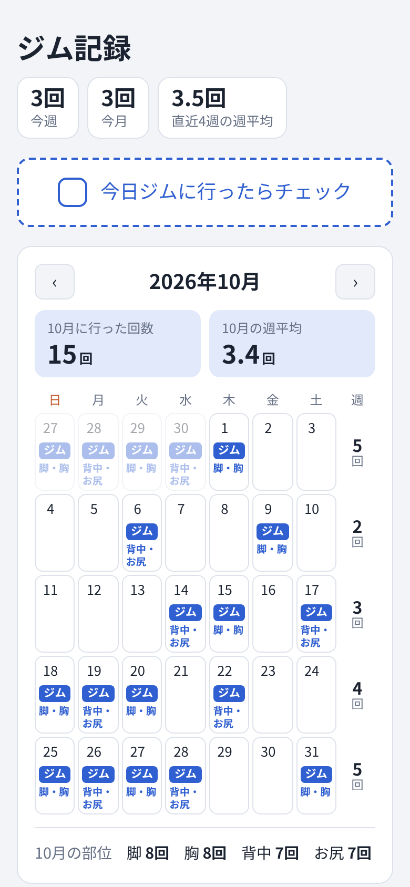
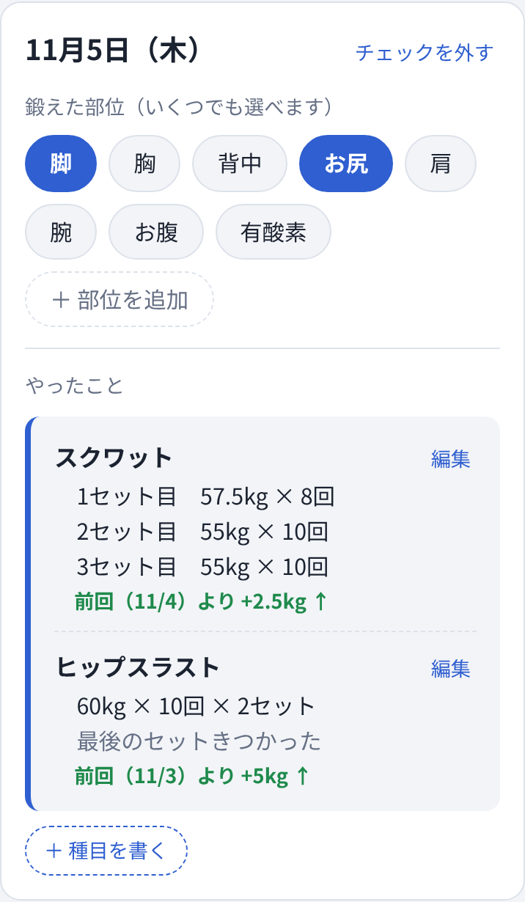
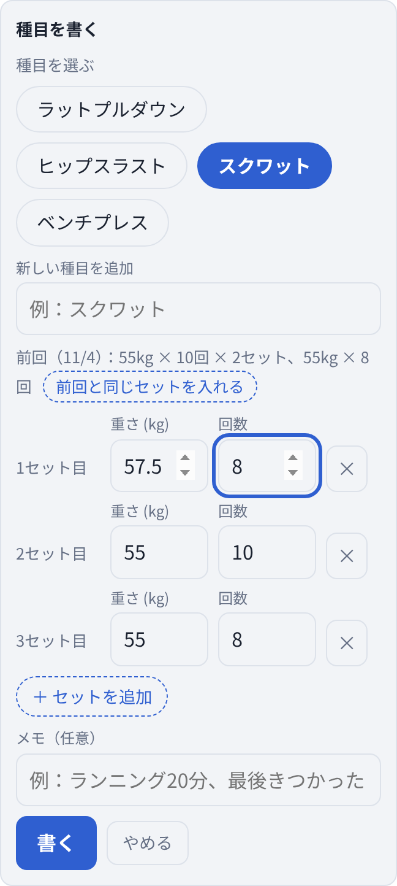
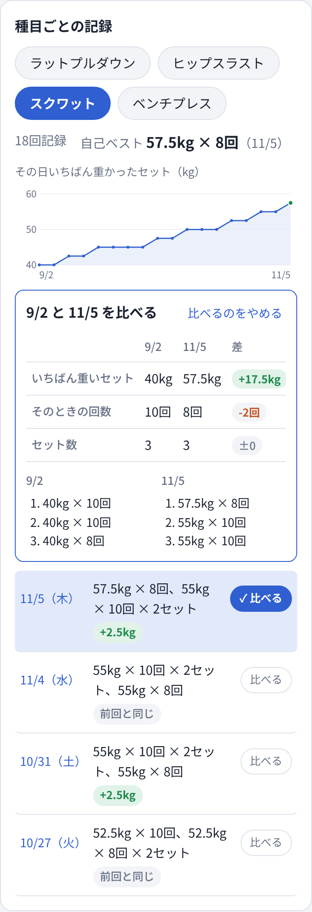

# ジム記録

ジムに行った日をカレンダーで見える化し、種目ごとの成長を前回と比べられる、シンプルなトレーニング記録アプリです。

**デモ：https://gym-log-taupe-phi.vercel.app** （スマホで開いて「ホーム画面に追加」すると、アプリのように使えます）

[](https://github.com/momo23546842/gym-log/actions/workflows/test.yml)

<p>
  
  
  
  
</p>

## このアプリを作った理由

私はもともと、ふだん使っているカレンダーアプリに、ジムに行った日は「ジム」と書き込んでいました。月にどれくらいジムに行けたのかを、自分の目で確かめたかったからです。カレンダーに「ジム」の日が増えていくこと自体が、私にとってのモチベーションでした。

最初は「ジム」と書くだけでしたが、そのうち、あとで見返せるように、その日にどんな種目をやったのかも日付のところにメモするようになりました。

ところが、記録が積み重なるにつれて、前回のトレーニングから自分がどれくらい成長したのかを比べたいと思うようになりました。そこで既存のトレーニングアプリを探してみましたが、

- 月のカレンダーに「ジム」と記録して、行った日をひと目で見られるアプリがほとんどない
- 種目は、あらかじめ用意された一覧から選ぶ必要がある

という2点が合いませんでした。用意された種目でたいていは足りたものの、自分がやっている種目の中には一覧にないものもありました。実際にいくつか使ってみたものの続かず、結局カレンダーに書き込むのがいちばん楽、というところに戻ってきてしまいました。

こうした経緯から、自分にとって使いやすいシンプルなアプリを、Claudeを使って作りました。

さらに、ジムでもその場でサッと記録できるように、GitHubにプロジェクトを作ってVercelで公開しました。公開したURLをスマホのホーム画面に追加すれば、ふつうのアプリと同じようにタップひとつで開いて使えます。

## 課題と解決

| 困っていたこと | このアプリでの解決 |
|---|---|
| 月に何回行けたかを、ひと目で見たい | カレンダーの行った日に「ジム」の帯。週ごとの回数、月の回数、週平均も表示 |
| 何をやったかを、あとで見返したい | 日付を押すと、その日の種目とセットがメモのように並ぶ |
| 前回からどれだけ伸びたか知りたい | 同じ種目の前回と自動で比べて「+2.5kg ↑」のように表示 |
| 好きな日どうしを比べたい | 種目ごとの推移グラフと、2日分を並べる比較表 |
| 決まった種目しか選べないと続かない | 種目は自分で作れる。一度入れた種目はボタンで使い回せる |

これまでTimeTreeに書いていた108日分の記録も、このアプリに移しました。

## 使い方

1. **ジムに行ったらチェック:** 一番上のボタンを押すだけで、今日に「ジム」の帯が付きます。
2. **鍛えた部位を選ぶ:** 脚・胸・背中などをいくつでも選べます。部位は自分で増やせます。
3. **種目を書く:** 登録した種目をボタンで選び、セットごとに重さと回数を入れます。「前回と同じセットを入れる」で前回の内容を呼び出して、変わったところだけ直せます。
4. **伸びを見る:** その日のメモに前回比が出ます。「種目ごとの記録」では推移のグラフと自己ベストを見られ、「比べる」で好きな2日を並べられます。
5. **バックアップ:** 「CSVファイルで保存」で、GoogleスプレッドシートやExcelで開けるファイルになります。別の端末へは「CSVから読み込む」で移せます。

## プロダクトとしての工夫

- **種目を固定しない:** 既存アプリが続かなかった一番の理由なので、種目は自由に作れるようにしました。そのうえで、同じ種目を同じ名前で記録しないと比較ができないため、一度入れた名前はボタンで選べるようにしています。表記がゆれてしまったときは「名前を変える」で過去の記録ごとまとめられます。
- **カレンダーを主役にする:** 「ジム」の帯が増えていく見た目がモチベーションだったので、記録より先にカレンダーが目に入る画面構成にしました。
- **比べるのは「その日いちばん重いセット」:** 重さが同じなら回数で比べます。セット数や回数がばらつく日でも、伸びを1つの数字で判断できるようにしました。
- **あえて入れなかったもの:** 総重量（重さ×回数の合計）は自分には必要ないと判断して入れていません。表示する数字を絞ったほうが、ジムで見たときに迷わないからです。
- **ジムで使うことを前提にする:** 大きなボタン、片手で押せるチェック、前回のセットの呼び出しなど、トレーニングの合間に数秒で記録できることを優先しました。
- **最初はログインなしにした:** すぐに使い始められることを優先して、記録は端末のブラウザに保存しています。代わりに端末をまたいだ同期ができないので、CSVでのバックアップと移行を用意しました（同期は今後の課題です）。

## 改善の流れ

自分で使いながら、気になったところを1つずつ直していきました。

1. ジムに行った日をチェックするだけの形で作る
2. カレンダーの「ジム」を、背景色つきの帯にする（今までのカレンダーと同じ見た目に）
3. 鍛えた部位を選べるようにする（複数選択）
4. 種目・重さ・回数のメモを付ける。その日を押したときだけ見える形に
5. セットごとに重さや回数を変えて記録できるようにし、あとから追記できるようにする
6. 表示中の月の回数と週平均を出す
7. 種目を自分で登録して使い回せるようにし、前回比・推移グラフ・2日の比較を付ける
8. コードを機能ごとに分け、テストと自動チェックを追加する

## 技術構成

| 項目 | 内容 |
|---|---|
| 言語 | JavaScript（ES Modules）、HTML、CSS |
| ライブラリ | なし（フレームワークもビルドも使わない） |
| データ保存 | ブラウザの localStorage |
| テスト | Node.js 標準のテストランナー（`node:test`） |
| CI | GitHub Actions（push とプルリクエストのたびにテストを実行） |
| 公開 | Vercel（静的ファイルとして配信） |

依存ライブラリを入れず、ビルドもしない構成にしました。小さなアプリなので、その分だけ動きを追いやすく、Vercelにもそのまま置けます。

```
index.html            画面の骨組み
css/style.css         見た目（ライト・ダークの両テーマ）
src/
  main.js             入り口。タップや入力を受けて状態を変える
  app.js              アプリの状態（保存する記録と、画面上の状態）
  storage.js          localStorage への読み書き
  lib/                画面に依存しない計算（テスト対象）
    dates.js          日付、月の回数、週平均
    records.js        セットのまとめ方、前回比、自己ベスト、種目名の変更
    csv.js            CSVの書き出しと読み込み
    chart.js          グラフの目盛り
    html.js           入力文字のエスケープ
  views/              状態から画面のHTMLを作る
    calendar.js / day.js / exercises.js / backup.js
tests/                lib/ のテスト
```

設計で意識したこと:

- **計算と画面を分ける:** 前回比や週平均などの計算は `src/lib/` に、画面に依存しない関数として置いています。そのため、ブラウザなしでテストできます。
- **入力した文字は必ずエスケープ:** 種目名やメモにHTMLのような文字を入れても、そのまま文字として表示されます（`src/lib/html.js`）。
- **CSVの安全対策:** メモが `=` などで始まると、Excelで開いたときに数式として実行されることがあるため、書き出すときに無害化し、読み込むときに元に戻しています。
- **古いデータも読める:** 最初のころは「重さ・回数・セット数」を1つずつ保存していました。今の「セットごと」の形と両方を読めるようにして、記録が消えないようにしています。

## テスト

```bash
npm test
```

日付と週平均、前回比、自己ベスト、種目名の変更、CSVの往復（書き出し→読み込みで元に戻るか）、エスケープなど、22件のテストがあります。タイムゾーンで日付がずれないことも、複数のタイムゾーンで確認しました。

## ローカルで動かす

ES Modules を使っているので、ファイルを直接開くのではなく、簡単なサーバー経由で開きます。

```bash
npm start   # http://localhost:8000 を開く
```

## Claudeとの役割分担

このアプリは、AIアシスタントのClaudeと一緒に作りました。

- **自分で決めたこと:** 何に困っているか、何を作るか・作らないか（例：種目は固定しない、総重量は入れない）、画面の見え方（「ジム」を帯にする、メモは日付を押したときだけ出す）、使ってみての改善点
- **Claudeに任せたこと:** コードを書くこと、実現方法の選択肢を出すこと、テストやコード整理

実際に使って「ここが使いにくい」と気づき、それを言葉にして直してもらう、という流れを繰り返して今の形になりました。

## 今後やりたいこと

- **ログインと同期:** どの端末からでも同じ記録を見られるようにする（Supabaseなどを検討中）
- **オフライン対応:** ジムの電波が弱くても開けて記録できるようにする（Service Worker）
- **通知とウィジェット:** 記録のリマインダーや、ホーム画面に今週の回数を出す
- **Google Play での公開**

## 注意

記録はブラウザの中に保存されるため、ブラウザのデータを消したり機種変更したりすると記録も消えます。ときどき「CSVファイルで保存」をしてください。
